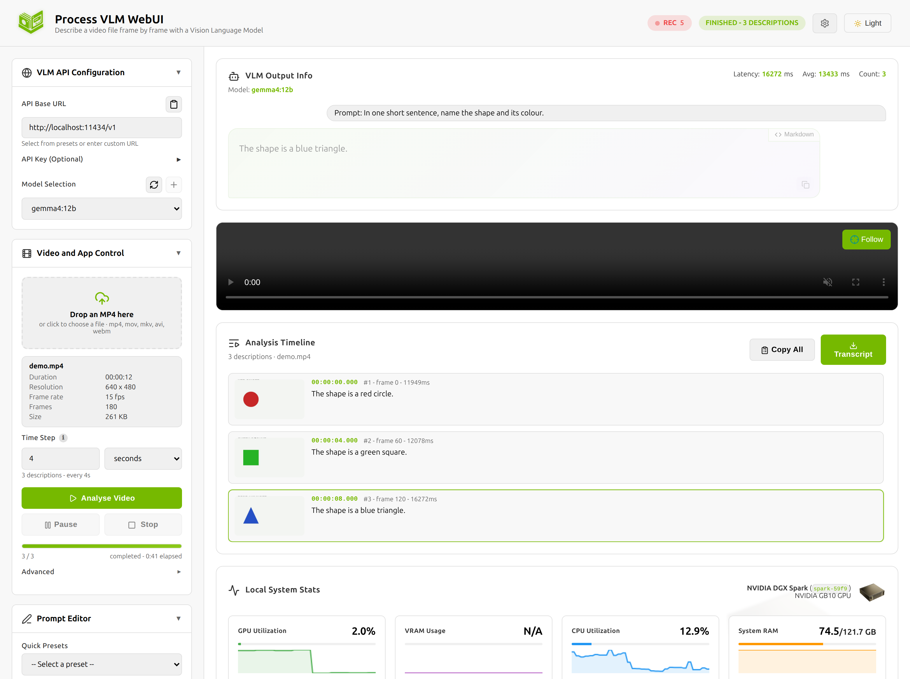
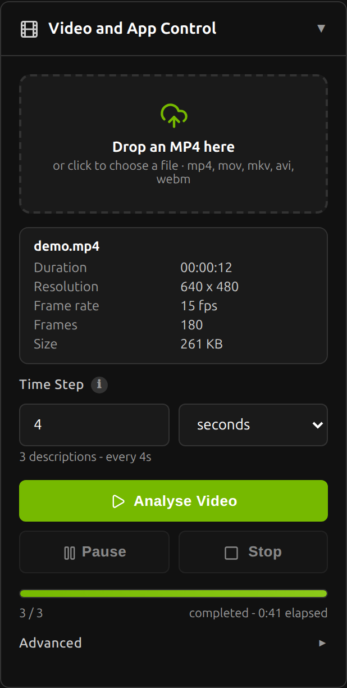

# Process VLM WebUI

Drop in an MP4, choose a time step, and get a timestamped description of the
whole video from a Vision Language Model - every analysis written durably to
disk as it happens.

This is the offline, file-based sibling of
[live-vlm-webui](https://github.com/nvidia-ai-iot/live-vlm-webui). It keeps that
project's UI, VLM backend support, GPU monitoring and transcript logging, and
replaces the live WebRTC camera feed with a video file you upload.

```
┌──────────────┐     ┌──────────────────┐     ┌───────────────┐     ┌──────────────┐
│  your .mp4   │ ──► │  sample every    │ ──► │   VLM         │ ──► │  transcript  │
│  (uploaded)  │     │  N seconds       │     │  (OpenAI API) │     │  (.jsonl)    │
└──────────────┘     └──────────────────┘     └───────────────┘     └──────────────┘
                              │                                            │
                              └──────────► live timeline in the browser ◄──┘
```



---

## What it does

- **Takes a video file.** Drag an `.mp4` (or `.mov`, `.mkv`, `.avi`, `.webm`)
  onto the page. The server probes it, stores it, and plays it back in the
  browser from its own copy - so the player and the analysis are looking at
  exactly the same file.
- **Samples it at a configurable time step.** "One description every 5 seconds"
  is the normal mode; you can also sample every Nth frame. A range
  (start/end) and a hard cap on the number of frames are available too. The
  panel tells you how many descriptions the current settings will produce
  *before* you start.
- **Describes each sampled frame** with any OpenAI-compatible VLM - Ollama,
  vLLM, SGLang, the NVIDIA API Catalog, OpenAI. One frame at a time, in video
  order.
- **Logs everything.** Each analysis is appended to a JSONL transcript, flushed
  and fsync'd before the next inference starts, with periodic backup snapshots.
  Every record carries the video timecode it came from.
- **Shows you the result as it builds.** A timeline of timecode + thumbnail +
  description streams into the page over a WebSocket. Click any entry to jump
  the player to that moment.

Runs as fast as the model allows - there is no realtime deadline, so unlike the
live app **no frame is ever dropped**: every frame in the plan gets described.

---

## Quick start

```bash
# 1. Install
git clone <this repo> process-vlm-webui
cd process-vlm-webui
python3 -m venv .venv
.venv/bin/pip install -e .

# 2. Have a VLM running (Ollama shown; see "VLM backends" below)
ollama pull gemma3:27b

# 3. Start
.venv/bin/process-vlm-webui --model gemma3:27b --api-base http://localhost:11434/v1
```

Open <http://localhost:8091>, drop in a video, set the time step, press
**Analyse Video**.

With no `--model`/`--api-base` the server auto-detects a local Ollama, vLLM or
SGLang, and falls back to the NVIDIA API Catalog (which needs `--api-key`).

> Unlike the live app, **HTTPS is not required** - there is no camera permission
> to grant, so plain HTTP is the default. Add `--ssl` if you want TLS.

---

## Using it

### 1. Load a video

Drag a file onto the drop zone, or click it to browse. The server probes the
file and shows its duration, resolution, frame rate and frame count. A file
OpenCV cannot decode is rejected there and then, with a reason.

### 2. Choose the time step

| Control | What it does |
| --- | --- |
| **Time step** | Seconds of video between analysed frames (or every Nth frame in `frames` mode) |
| **Start / End** | Analyse only part of the video |
| **Max frames** | Stop after this many descriptions (0 = no limit) |
| **Frame width** | Downscale before inference - smaller is faster and cheaper (0 = original) |
| **Carry previous description** | Quote the last description in the next prompt, so the model describes a continuing scene instead of unrelated stills |

The hint under the step field updates live: *"120 descriptions - every 5s"*.
That number times your model's latency is roughly how long the run will take.

### 3. Write the prompt

The **Prompt Editor** applies to every sampled frame. The presets include
video-oriented ones (Video Narration, Action Log, Shot Inventory) alongside the
still-image ones. Whatever is in the box when you press Analyse is what gets
sent - and what gets recorded in the transcript.

### 4. Watch it run

Progress, ETA and each description stream into the page. Pause and Stop work
mid-run; a pause takes effect after the frame in flight finishes.



### 5. Take the results

- **Copy All** puts the whole timeline on the clipboard as `[timecode] text`.
- **Transcript** downloads the JSONL file.
- The transcript is on the server's disk regardless - see below.

---

## Where the output goes

Everything lands under the platform data directory
(`~/.local/share/process-vlm-webui/` on Linux):

```
~/.local/share/process-vlm-webui/
├── transcripts/
│   ├── session-20260921-153244.jsonl     ← every analysis, as it happened
│   └── backups/                          ← periodic snapshots
├── videos/                               ← uploaded files
└── frames/<job-id>/                      ← the JPEG of each analysed frame
```

One analysis record looks like this:

```json
{
  "seq": 3,
  "ts": "2026-09-21T15:33:38.415+02:00",
  "ts_epoch": 1789997618.416,
  "kind": "analysis",
  "model": "gemma4:12b",
  "api_base": "http://localhost:11434/v1",
  "prompt": "Describe this frame in one short sentence.",
  "response": "A red circle on a white background.",
  "latency_ms": 36160.5,
  "ok": true,
  "source": "video:demo.mp4",
  "job_id": "7e9bf8c75c93",
  "video": "demo.mp4",
  "step": 1,
  "step_total": 4,
  "frame_index": 0,
  "video_time_s": 0.0,
  "timecode": "00:00:00.000",
  "step_mode": "seconds",
  "step_seconds": 3.0,
  "frame_file": "00001_f0.jpg"
}
```

A run is bracketed by `video_job_start` and `video_job_end` records, so a single
transcript file holding several runs can still be split cleanly per video.

`--transcript-format txt` writes one human-readable line per analysis instead.
`--no-transcript` turns recording off entirely.

Pull the descriptions back out with two lines of Python:

```python
import json
rows = [json.loads(l) for l in open("session-20260921-153244.jsonl")]
for r in (r for r in rows if r["kind"] == "analysis"):
    print(r["timecode"], r["response"])
```

---

## Command line

```
process-vlm-webui [--model M] [--api-base URL] [--api-key KEY] [--prompt TEXT]
                  [--host H] [--port P] [--auto-port]
                  [--step SECONDS | --step-frames N] [--max-width PX]
                  [--carry-context] [--video PATH]
                  [--videos-dir DIR] [--frames-dir DIR] [--no-save-frames]
                  [--max-upload-mb MB] [--allow-server-paths]
                  [--ssl] [--ssl-cert PATH] [--ssl-key PATH]
                  [--no-transcript] [--transcript-dir DIR] [--transcript-file PATH]
                  [--transcript-format {jsonl,txt}] [--transcript-backup-every N]
                  [--transcript-backup-keep K] [--transcript-max-bytes BYTES]
                  [--no-transcript-fsync]
```

The settings that matter most:

| Flag | Default | Notes |
| --- | --- | --- |
| `--step SECONDS` | `2.0` | Seconds between analysed frames. This is the UI's starting value too. |
| `--step-frames N` | off | Sample every Nth frame instead of a time step. |
| `--max-width PX` | `1280` | Downscale before inference. The single biggest lever on speed and token cost. |
| `--carry-context` | off | Feed the previous description into each prompt. |
| `--video PATH` | - | Register a local file at startup so it is ready in the UI. |
| `--no-save-frames` | off | Skip the per-frame JPEGs (saves disk, loses the timeline thumbnails). |
| `--allow-server-paths` | off | Let clients analyse any path on this machine. Off because the server binds `0.0.0.0` by default. |
| `--port P` | `8091` | Deliberately not 8090, so it can run beside live-vlm-webui. |

Stop a running server with `process-vlm-webui-stop`.

---

## HTTP API

Everything the UI does is available directly.

| Method | Endpoint | Purpose |
| --- | --- | --- |
| `POST` | `/api/video/upload` | multipart upload, field name `file`; returns the probed metadata |
| `POST` | `/api/video/register` | analyse a file already on the server (needs `--allow-server-paths`) |
| `GET` | `/api/video/list` | registered videos |
| `GET` | `/api/video/file/{video_id}` | the video itself, with range support |
| `POST` | `/api/video/start` | begin a job (see options below) |
| `POST` | `/api/video/pause` | `{"paused": true|false}` |
| `POST` | `/api/video/stop` | cancel the running job |
| `GET` | `/api/video/status` | state, progress, rate, ETA |
| `GET` | `/api/video/results` | the descriptions produced so far |
| `GET` | `/api/video/jobs` | every job this session |
| `GET` | `/api/video/frame/{job_id}/{name}` | one analysed frame as JPEG |
| `POST` | `/api/video/delete` | forget a video and delete its upload |
| `GET` | `/api/transcript/status` \| `/recent` \| `/download` | transcript state and contents |
| `POST` | `/api/transcript/backup` \| `/config` | snapshot now; pause/resume recording |

Describing a whole video from a shell:

```bash
VIDEO=$(curl -s -F "file=@clip.mp4" localhost:8091/api/video/upload \
        | python3 -c 'import json,sys; print(json.load(sys.stdin)["video"]["video_id"])')

curl -s -X POST localhost:8091/api/video/start \
     -H 'Content-Type: application/json' \
     -d "{\"video_id\":\"$VIDEO\",\"step_seconds\":5,\"max_width\":768}"

# ...then poll, or just read the transcript as it is written
curl -s "localhost:8091/api/video/results" \
     | python3 -c 'import json,sys; [print(r["timecode"], r["text"]) for r in json.load(sys.stdin)["results"]]'
```

Only one job runs at a time; starting a second returns `409` with the running
job's status.

---

## VLM backends

Any OpenAI-compatible `/v1/chat/completions` endpoint that accepts an image.

```bash
# Ollama
ollama pull gemma3:27b
process-vlm-webui --model gemma3:27b --api-base http://localhost:11434/v1

# vLLM
vllm serve llava-hf/llava-1.5-7b-hf --port 8000
process-vlm-webui --model llava-hf/llava-1.5-7b-hf --api-base http://localhost:8000/v1

# NVIDIA API Catalog
process-vlm-webui --model meta/llama-3.2-11b-vision-instruct \
                  --api-base https://integrate.api.nvidia.com/v1 --api-key nvapi-...
```

### How long will it take?

Wall-clock is `frames x model latency`, and frames is
`video duration / time step`. A 10-minute video at a 5-second step is 120
frames; at 2 s/frame that is 4 minutes of inference. Turning `--max-width` down
is usually the fastest way to make that number smaller.

---

## Development

```bash
python3 -m venv .venv
.venv/bin/pip install -e ".[dev]"
.venv/bin/python -m pytest tests/ -q     # unit + integration
.venv/bin/python -m black src/ tests/
.venv/bin/python -m ruff check src/ tests/
```

The tests generate real (tiny) videos with OpenCV rather than shipping binary
fixtures, so the sampling assertions are checked against a file that actually
has to be decoded. No model is needed - the VLM is stubbed.

### Project layout

```
src/process_vlm_webui/
├── server.py           # aiohttp app: upload, job control, transcript API, WebSocket
├── video_analyzer.py   # probing, sample planning, the analysis job itself
├── vlm_service.py      # OpenAI-compatible VLM client
├── transcript.py       # durable JSONL/txt writer with backups
├── gpu_monitor.py      # NVIDIA / Jetson / Apple Silicon system stats
└── static/index.html   # the whole UI
```

---

## Differences from live-vlm-webui

| | live-vlm-webui | process-vlm-webui |
| --- | --- | --- |
| Input | webcam or RTSP, over WebRTC | a video file you upload |
| Transport | WebRTC peer connection | plain HTTP upload + `<video>` playback |
| Sampling | every Nth frame, dropped when busy | every Nth frame or every N seconds, never dropped |
| Pacing | realtime, best effort | as fast as the model allows |
| Output | latest description | full timeline with thumbnails and timecodes |
| HTTPS | required (camera permission) | optional (`--ssl`) |
| Default port | 8090 | 8091 |
| Dependencies | + aiortc, av, aiohttp-cors | those removed |

`transcript.py` and `gpu_monitor.py` are carried over unchanged in behaviour, so
transcripts from both apps read the same way.

---

## License

Apache-2.0. Derived from
[NVIDIA-AI-IOT/live-vlm-webui](https://github.com/nvidia-ai-iot/live-vlm-webui);
see [LICENSE](LICENSE).
